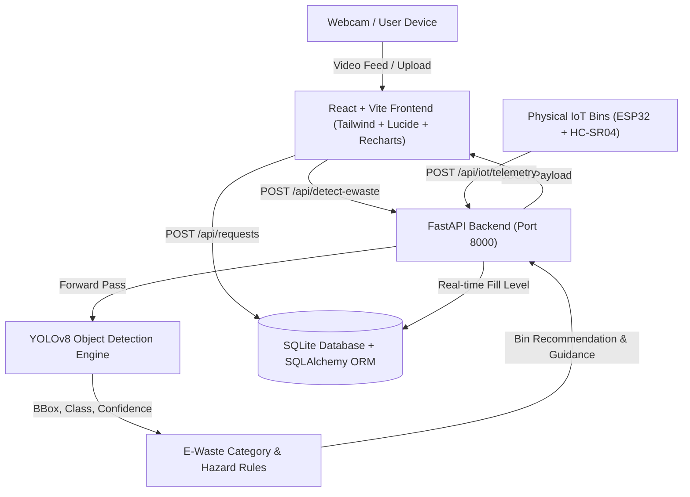

# Smart E-Waste Management System with AI Camera Detection & IoT Monitoring

An intelligent full-stack electronic waste management platform combining live computer vision object detection (YOLOv8), automated collection bin recommendation, hazardous material safety protocols, smart IoT ultrasonic bin monitoring, and doorstep recycling logistics.

---

## 1. System Architecture & Tech Stack



### Technology Stack:
- **Frontend**: React.js 18, Vite 5, Tailwind CSS, Lucide React Icons, Recharts Analytics
- **Backend**: Python 3.11, FastAPI, SQLAlchemy ORM, SQLite, Pydantic v2
- **AI / Computer Vision**: Ultralytics YOLOv8, PyTorch, Pillow, OpenCV
- **Authentication**: JWT (JSON Web Tokens), Passlib / Bcrypt password hashing, Role-Based Access Control (RBAC)
- **IoT Microcontroller Protocol**: HTTP REST Telemetry for Arduino / ESP32 + HC-SR04 Ultrasonic Sensors

---

## 2. Default Demo Accounts

| Role | Email | Password | Access Capabilities |
|---|---|---|---|
| **Administrator** | `admin@ewaste.org` | `Admin@123` | Full access: request status pipeline management, collection center CRUD, user directory, CSV export |
| **Recycler (User)** | `demo@ewaste.org` | `User@123` | Personal dashboard, schedule collection requests, tracking, camera detection history |

*Note: One-click instant login buttons are also provided directly on the Sign In page.*

---

## 3. Seven Core E-Waste Categories & Bin Allocation

| Category | Primary Detected Items | Designated Smart Bin | Hazard Handling Protocol |
|---|---|---|---|
| **Mobile Phones & Gadgets** | Smartphones, tablets, smartwatches, PDAs | Mobile & Gadgets | Factory reset data, remove SIM/SD cards. Safe for precious metal extraction. |
| **Computers & Accessories** | Laptops, keyboards, mice, motherboards, PCs | Computers & Accessories | Secure data destruction. Diverts aluminum and toxic lead solders. |
| **Batteries** | Li-ion, power banks, alkaline, dry cells | Battery Collection | **CRITICAL FIRE HAZARD**: Tape terminals; do NOT drop damaged/swollen units in ordinary bins. Store in sand. |
| **Cables & Chargers** | USB cords, power adapters, HDMI cables | Cables & Chargers | Bundle with ties; 100% recyclable copper core granulator. |
| **TVs & Monitors** | LED screens, monitors, displays, CRT | TVs & Monitors | Handle with care to prevent toxic phosphor and mercury vapor release. |
| **Other Electronic Waste** | Microwaves, remotes, toasters, small appliances | General E-Waste Assessment | Disassemble for copper coils, transformers, and plastics. |
| **Unknown / Not E-Waste** | Non-electronic items / low confidence | Unclassified / Review | Prompts user to center device closer or select manually. |

---

## 4. Setup & Running Instructions (Windows & VS Code)

### Prerequisites:
- Python 3.11 (`C:\Users\Asus\AppData\Local\Programs\Python\Python311\python.exe`)
- Node.js v20+ (`C:\Users\Asus\AppData\Local\Programs\nodejs\node.exe`)

### Step 1: Clone / Open Project
In VS Code, open the folder:
`C:\Users\Asus\.gemini\antigravity\scratch\smart-ewaste-system`

### Step 2: Start the Backend Server (Terminal 1)
```powershell
cd backend
$py = "C:\Users\Asus\AppData\Local\Programs\Python\Python311\python.exe"
& $py -m uvicorn app.main:app --host 127.0.0.1 --port 8000 --reload
```
The FastAPI backend will start at `http://127.0.0.1:8000`.
- Swagger API Docs: `http://127.0.0.1:8000/docs`
- ReDoc API Docs: `http://127.0.0.1:8000/redoc`

For deployments, set a persistent `SECRET_KEY` environment variable. If it is not set, the backend generates a random key at startup, so existing login tokens will expire after a restart.

### Step 3: Start the Frontend Vite Dev Server (Terminal 2)
```powershell
cd frontend
$nodeDir = "C:\Users\Asus\AppData\Local\Programs\nodejs"
$env:Path = "$nodeDir;" + $env:Path
& "$nodeDir\npm.cmd" run dev
```
Open `http://localhost:5173` in your web browser.

---

## 5. Running Automated Backend & E2E Tests

Run the full pytest suite:
```powershell
cd backend
$py = "C:\Users\Asus\AppData\Local\Programs\Python\Python311\python.exe"
& $py -m pytest tests -v
```

Run the live API and AI inference verification script:
```powershell
cd backend
$py = "C:\Users\Asus\AppData\Local\Programs\Python\Python311\python.exe"
& $py verify_live_api.py
```

---

## 6. AI Model Fine-Tuning Guide (Custom Datasets)

While base YOLOv8 accurately detects common electronic devices (smartphones, laptops, monitors, keyboards, remotes), you can fine-tune it on custom annotated e-waste datasets (e.g., fragmented PCBs, specialized industrial cables):

1. **Obtain Dataset**: Download e-waste bounding box annotations in YOLO format from Roboflow Universe (`https://universe.roboflow.com/search?q=e-waste`) or Kaggle.
2. **Execute Fine-Tuning**:
   ```powershell
   cd backend
   $py = "C:\Users\Asus\AppData\Local\Programs\Python\Python311\python.exe"
   & $py app/ai/model_trainer_guide.py --train data.yaml
   ```
3. **Deploy Trained Weights**:
   Copy the exported `best.pt` file into `backend/app/ai/weights/best.pt`. The detector will automatically detect and prioritize it on next startup.

---

## 7. Smart IoT Hardware Integration (ESP32 / Arduino)

Connect an HC-SR04 ultrasonic distance sensor to an ESP32 microcontroller mounted under the container lid:

```cpp
#include <WiFi.h>
#include <HTTPClient.h>

const int TRIG_PIN = 5;
const int ECHO_PIN = 18;
const char* serverUrl = "http://YOUR_BACKEND_IP:8000/api/iot/telemetry";

void sendBinTelemetry() {
  digitalWrite(TRIG_PIN, LOW); delayMicroseconds(2);
  digitalWrite(TRIG_PIN, HIGH); delayMicroseconds(10);
  digitalWrite(TRIG_PIN, LOW);
  long duration = pulseIn(ECHO_PIN, HIGH);
  float distanceCm = duration * 0.034 / 2;

  HTTPClient http;
  http.begin(serverUrl);
  http.addHeader("Content-Type", "application/json");
  String payload = "{\"bin_code\":\"BIN-MOBILE-01\",\"distance_cm\":" + String(distanceCm) + ",\"total_depth_cm\":100.0}";
  int httpCode = http.POST(payload);
  http.end();
}
```

The system automatically switches the bin from `Simulated` to `Live Hardware` upon receiving sensor packets.

---

## 8. API Endpoint Reference

| Method | Endpoint | Description |
|---|---|---|
| `POST` | `/api/detect-ewaste` | Upload image from camera, runs YOLO inference, returns category, bounding box, bin recommendation |
| `GET` | `/api/detections` | Returns user's scanned items history |
| `POST` | `/api/requests` | Creates a new collection request with unique code (`EW-YYYYMMDD-XXXX`) |
| `GET` | `/api/requests` | Lists requests (filtered by user or all for admin) |
| `GET` | `/api/requests/track/{code}` | Public tracking endpoint with 5-stage status progress |
| `PATCH` | `/api/requests/{id}/status` | Admin status transition (Pending → Approved → Scheduled → Collected → Recycled) |
| `DELETE`| `/api/requests/{id}/cancel` | User cancellation for eligible pending requests |
| `GET` | `/api/centers` | Search & filter collection centers by location and accepted categories |
| `POST` | `/api/centers` | Admin creation of new recycling centers |
| `GET` | `/api/iot/bins` | Real-time fill levels and capacity for all 4 smart bins |
| `POST` | `/api/iot/telemetry` | Ingests live HC-SR04 ultrasonic telemetry packets from ESP32/Arduino |
| `POST` | `/api/iot/bins/{code}/simulate`| Adjusts bin level in demo simulation mode |
| `GET` | `/api/analytics/overview` | Aggregated statistics for Recharts interactive dashboards |
| `GET` | `/api/admin/export-requests-csv` | Logistics dispatch CSV spreadsheet download |
| `POST` | `/api/auth/login` | Authenticates user and returns JWT token |
| `POST` | `/api/auth/register` | Registers new user account |

---

© 2026 Smart E-Waste Management System. Developed with Google DeepMind Antigravity.
